# 🛍️ PocketStore – Catálogo Offline con Vanilla JS

**Autor:** Santiago Medellin Salcedo
**Grupo:** IDGS101N
**Materia:** APLICACIONES WEB PROGRESIVAS
**Modalidad:** Desarrollo individual
**Fecha:** 2 de octubre de 2026
**Demo:** [URL DE GITHUB PAGES](https://github.com/byfelc/-PocketStore-Cat-logo-Offline-con-Vanilla-JS-_Santiago)

---

## 1. Introducción

PocketStore es una aplicación web de una sola página (SPA) que muestra un catálogo de elementos y funciona **sin conexión a internet**. Está desarrollada con HTML, CSS y JavaScript puro, sin frameworks, y aplica los principios de una Progressive Web App (PWA): App Shell, Service Worker, caché y manifiesto de instalación.

## 2. Objetivo

Construir una aplicación que cargue al instante, consuma datos de una API pública y siga siendo utilizable cuando el usuario pierde la conexión, además de poder instalarse como una aplicación independiente.

## 3. Tecnologías utilizadas

| Tecnología | Uso |
|---|---|
| HTML5 | Estructura del App Shell |
| CSS3 | Estilos y diseño responsivo |
| JavaScript (Vanilla) | Lógica, consumo de API y filtros |
| Service Worker | Control de red y modo offline |
| Cache API | Almacenamiento de archivos y datos |
| Web App Manifest | Instalación como aplicación |
| JSONPlaceholder | API pública de datos |


## 4. Estructura del proyecto

```
pocket-store/
├── index.html         # Vista (App Shell)
├── styles.css         # Estilos del App Shell
├── app.js             # Lógica de la aplicación y registro del SW
├── sw.js              # Service Worker y caché
├── manifest.json      # Configuración de instalación
├── icons/             # Iconos 192x192 y 512x512
└── docs/              # Capturas del proceso de desarrollo
```
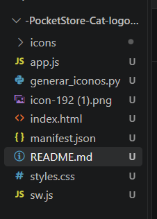
## 5. Desarrollo

### 5.1 Manifiesto (`manifest.json`)

Se creó el archivo manualmente con la información necesaria para instalar la aplicación:

- `name` y `short_name`: nombre completo y nombre corto de la app.
- `start_url`: página que se abre al iniciar la app instalada.
- `display: "standalone"`: la app se abre sin la barra del navegador.
- `theme_color` y `background_color`: colores corporativos (`#4f46e5` y `#0f172a`).
- `icons`: dos iconos, de 192x192 y 512x512 píxeles.


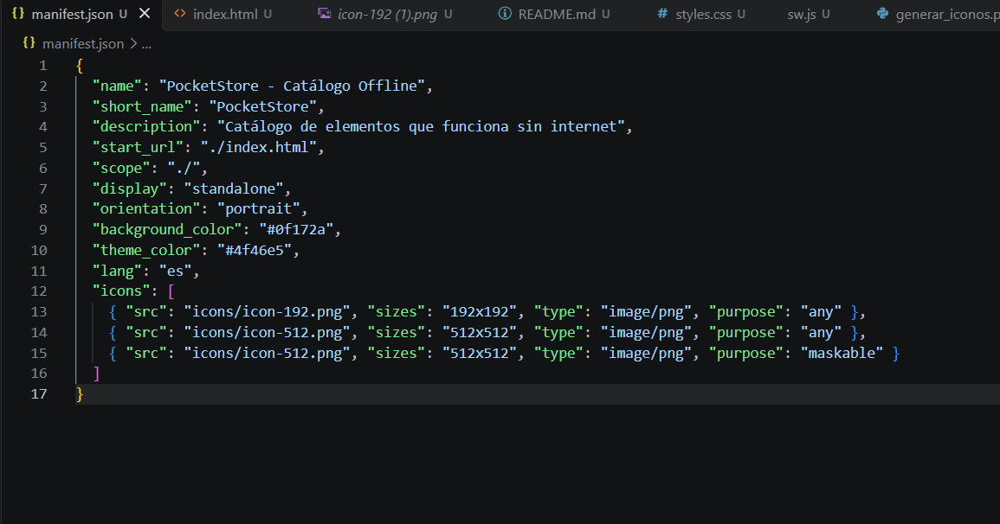

### 5.2 App Shell (`index.html` y `styles.css`)

El App Shell es la estructura visual fija de la aplicación. Se compone de:

- **Barra superior** con el título e indicador de estado de conexión (En línea / Sin conexión).
- **Contenedor principal** con un banner, botones de categoría, buscador y la lista de elementos.
- **Pie de página** con información del proyecto.

Al ser contenido estático guardado en caché, se muestra de forma instantánea mientras el contenido dinámico se carga después. El diseño usa CSS Grid y es responsivo.
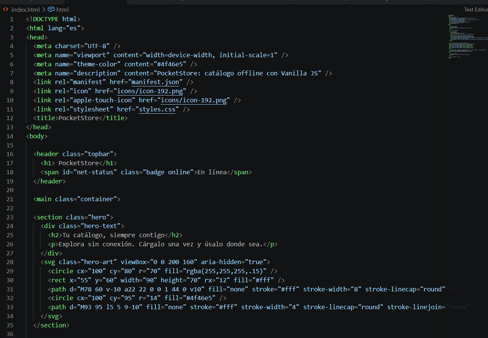
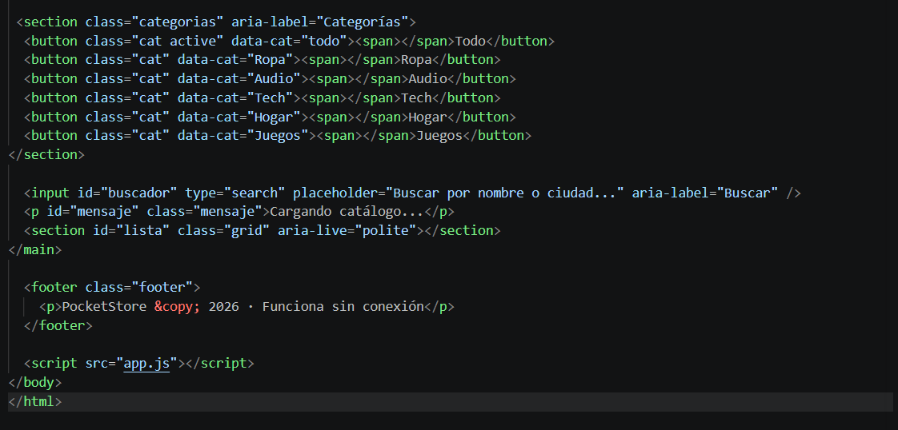

### 5.3 Service Worker (`sw.js`)

Se programó el ciclo de vida completo del Service Worker:

- **install:** abre la caché y almacena los archivos del App Shell (`index.html`, `styles.css`, `app.js`, `manifest.json` e iconos).
- **activate:** elimina las cachés de versiones anteriores para evitar archivos obsoletos.
- **fetch:** intercepta cada petición y decide cómo responderla según su tipo.

Estrategias de caché utilizadas:

| Recurso | Estrategia | Descripción |
|---|---|---|
| App Shell (HTML, CSS, JS) | Cache First | Responde desde la caché; solo va a la red si no existe |
| Datos de la API | Network First | Intenta la red y guarda una copia; sin internet usa la última copia guardada |
| Imágenes externas | Cache First | Se guardan la primera vez que se ven y luego se leen de la caché |

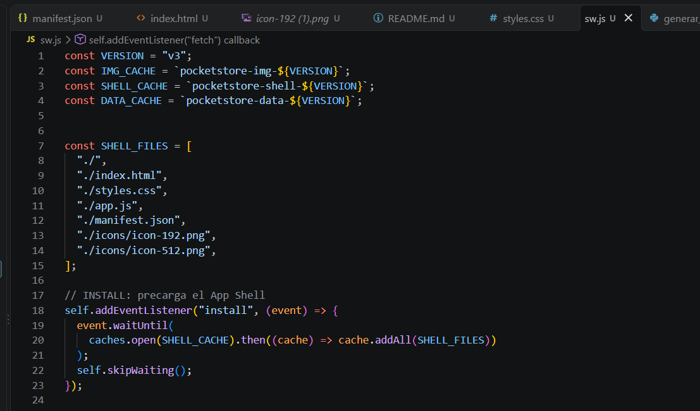
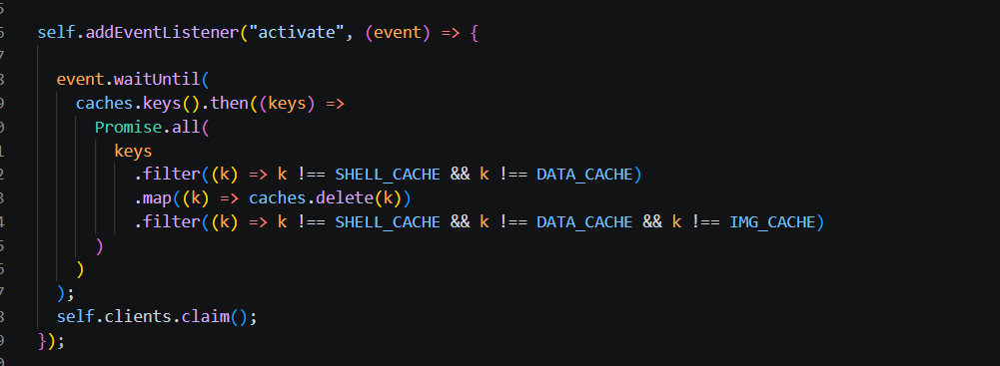
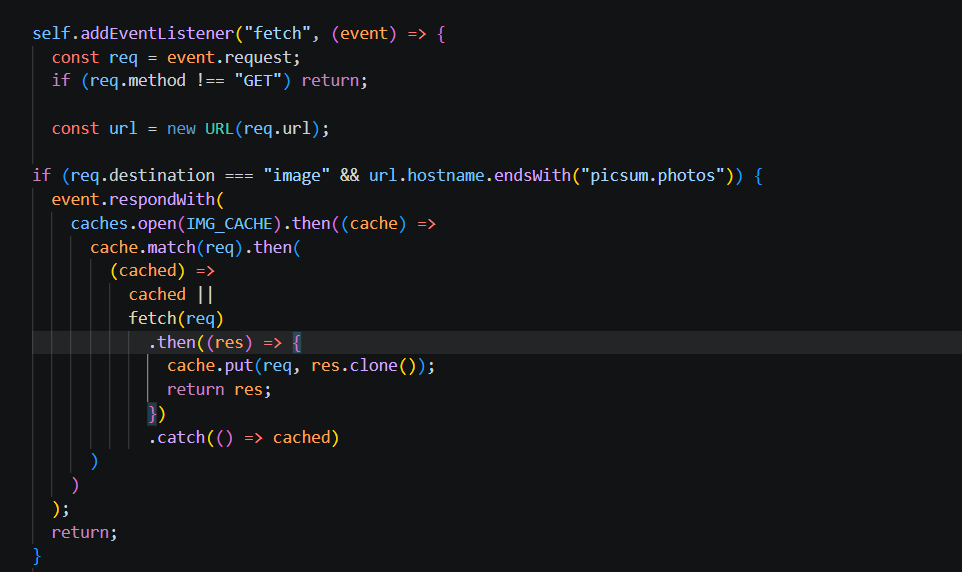
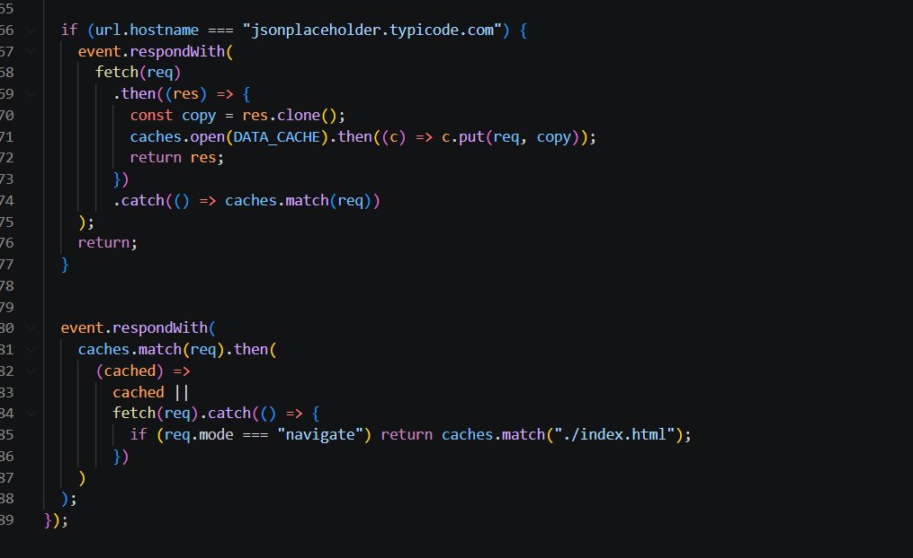
### 5.4 Contenido dinámico (`app.js`)

El archivo `app.js` se encarga de:

1. **Registrar el Service Worker** al cargar la página.
2. **Consumir la API** de JSONPlaceholder con `fetch()` (`/users`) y mostrar cada elemento como una tarjeta con imagen, nombre, correo, empresa y ciudad.
3. **Asignar una categoría** a cada elemento (Ropa, Audio, Tech, Hogar, Juegos) para poder filtrarlos.
4. **Filtrar** por categoría mediante botones y por texto mediante el buscador; ambos filtros funcionan al mismo tiempo.
5. **Mostrar el estado de conexión** usando los eventos `online` y `offline` del navegador.

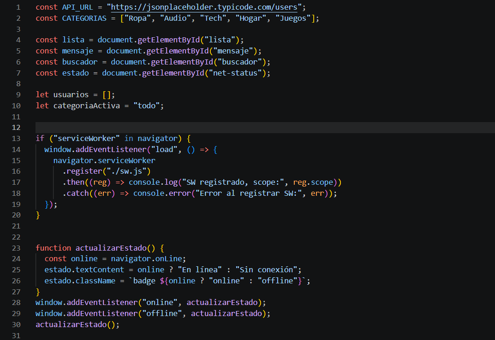
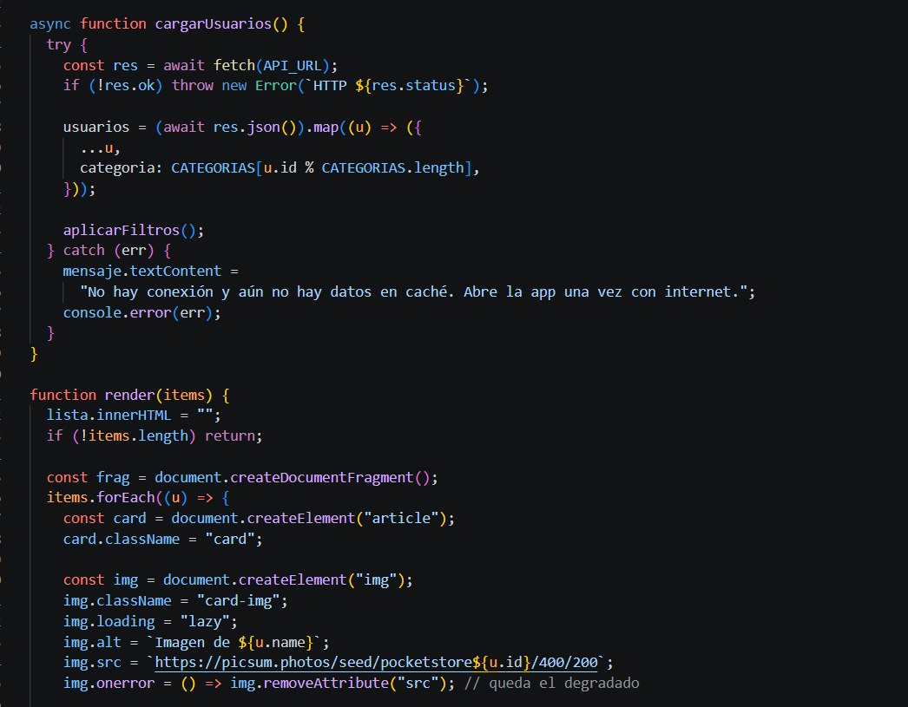
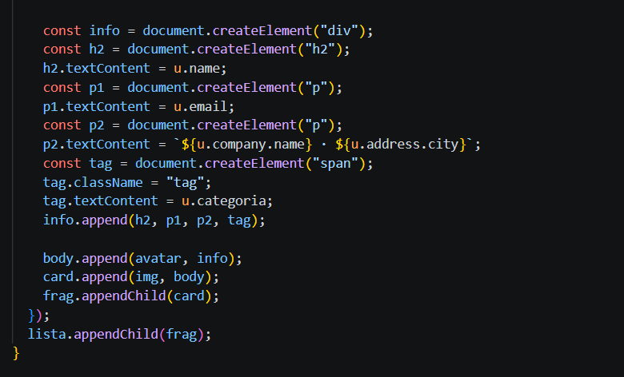
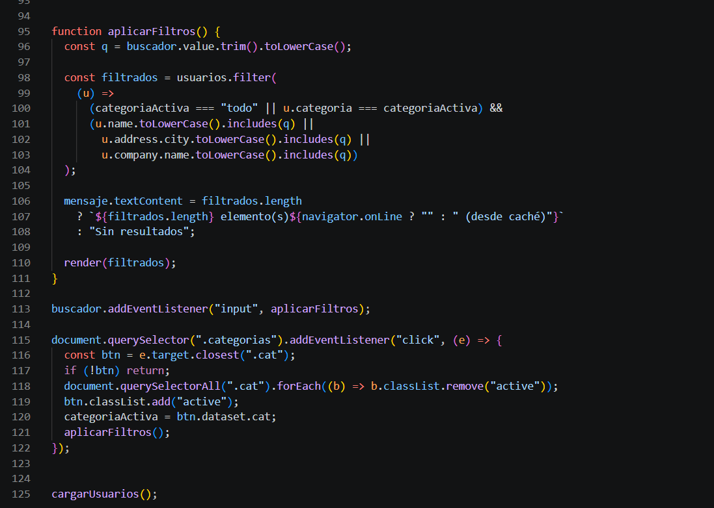

## 6. Pruebas realizadas

### Funcionamiento sin conexión

1. Abrir la aplicación con internet y esperar a que cargue la lista.
2. En DevTools (F12) → *Application* → *Service Workers*, verificar que esté en estado **activated**.
3. En *Application* → *Cache Storage*, comprobar que existen las cachés de la aplicación.
4. Activar la opción **Offline** y recargar la página.
5. Resultado: la aplicación, la lista y los filtros siguen funcionando, y el indicador cambia a "Sin conexión".

!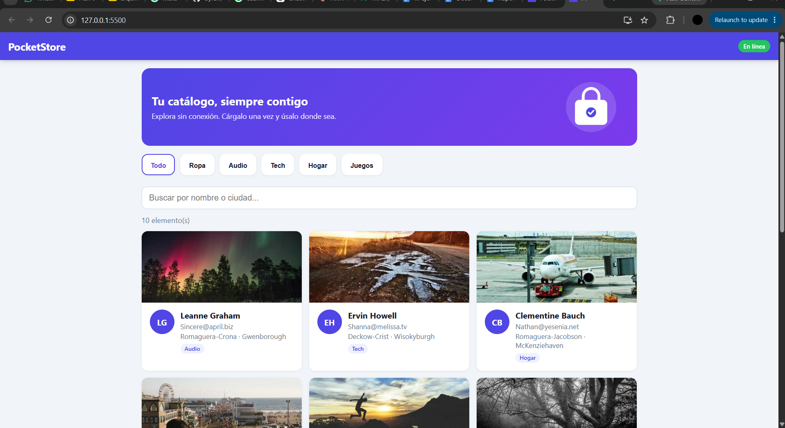


## 7. Cómo ejecutar el proyecto

Los Service Workers solo funcionan en `localhost` o en HTTPS. Para correrlo de forma local:

```bash
git clone URL_DEL_REPOSITORIO
cd pocket-store
python -m http.server 8000
```

Después abrir `http://localhost:8000` en el navegador.

## 8. Conclusiones

El proyecto permitió comprender cómo trabajan en conjunto el App Shell, el Service Worker y la Cache API para ofrecer una experiencia rápida y disponible sin conexión. Elegir la estrategia de caché adecuada para cada tipo de recurso (Cache First para lo estático y Network First para los datos) permite que la aplicación se mantenga actualizada cuando hay internet y siga siendo útil cuando no la hay.

## 9. Referencias

- MDN Web Docs – Service Worker API: https://developer.mozilla.org/es/docs/Web/API/Service_Worker_API
- MDN Web Docs – Web App Manifest: https://developer.mozilla.org/es/docs/Web/Manifest
- JSONPlaceholder: https://jsonplaceholder.typicode.com/